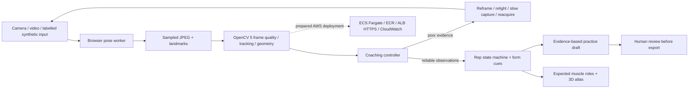

# RepAnatomy

**Every rep. A little clearer.**

RepAnatomy connects exercise practice with an interactive 3D anatomy atlas. Gym Studio combines browser pose estimation, substantive **OpenCV 5** frame analysis, rep tracking, expected muscle targets and a coaching controller whose decisions change when the visual evidence changes.

Built for the **OpenCV AI Competition 2026, powered by AWS**. This folder contains a working local prototype and an AWS deployment package. **AWS execution, a judge-accessible endpoint and a new submission video remain pending.** See the [competition checklist](docs/opencv/SUBMISSION_CHECKLIST.md) before making eligibility claims.


## Run locally

Use Node.js **24.22.1** (minimum 22.18), Python **3.12**, and a current Chromium browser. Start from the folder containing `package.json`.

```powershell
npm ci
npm run prepare:pose
python -m venv .venv
.venv\Scripts\python.exe -m pip install -r backend/requirements.lock.txt
```

Terminal 1:

```powershell
.venv\Scripts\python.exe -m uvicorn backend.main:app --host 127.0.0.1 --port 8000 --no-access-log
```

Terminal 2:

```powershell
npm run dev
```

Open **[Gym Studio](http://localhost:3016/?gym=1)**. The [anatomy atlas](http://localhost:3016/) and [report companion](http://localhost:3016/?demo=1) remain available. No paid AI key is needed for fitness coaching or the synthetic demonstration. For macOS/Linux, use `.venv/bin/python` instead of `.venv\Scripts\python.exe`.

`prepare:pose` downloads a versioned pose model, checks its pinned SHA-256 and copies the matching WASM runtime into `public/pose`. Camera inference then uses local assets. The frontend development server proxies `/api` and `/mcp` to the backend. Use `REPANATOMY_API_TARGET` to select a different backend. [Detailed setup and use guide](docs/opencv/RUN_AND_USE.md).

## Use Gym Studio

1. Select **bodyweight squat, push-up, biceps curl, shoulder press or forward lunge**.
2. Choose **Try synthetic demo** to check the complete flow without a camera. The engineering demonstration uses generated observations; it is not human accuracy evidence.
3. For your own practice, enable the frame processing consent checkbox, then choose **Use camera** or **Open video**. Use a side view with one person in frame. Camera access requires localhost or HTTPS.
4. Watch rep cycles, joint visibility, approximate joint angles and actionable cues. Poor lighting, blur, occlusion or tracking discontinuities pause counting. A completed cycle is not a safety certification.
5. Review expected primary and supporting muscle roles. **Meet the muscle** opens the relevant structure in the 3D atlas. Camera video cannot measure muscle activation or establish that another muscle is inactive.
6. Stop capture and open **My practice plan**. Choose food preferences, exclusions and practice days. Visual observations select either a technique-review draft or a conservative practice draft. Review the draft to enable export. Medical needs and pain redirect to human review.
7. Inspect **Vision evidence**, export the decision trace or delete the session. A reported pain/dizziness stop is latched for that session.

## What runs in OpenCV 5

The server decodes JPEG frames, rescales and converts images to grayscale, measures Laplacian sharpness and exposure, tracks observations with pyramidal Lucas–Kanade optical flow, and projects normalized pose observations into pixel geometry. These results gate form cues and rep counting, change capture cadence, and influence the later practice draft.

Browser pose inference runs in a worker using a pinned MediaPipe Pose Landmarker model. A BODY_25 observation import adapter is also available. Exercise selection is explicit; heuristic pose suggestions are not a validated automatic exercise classifier. No pretrained classifier accuracy from other applications is claimed.



## Verify

```powershell
npm run check
npm run lint
npm test
.venv\Scripts\python.exe -m unittest backend.test_fitness -v
.venv\Scripts\python.exe backend/test_backend.py
.venv\Scripts\python.exe -m unittest backend.test_mcp -v
npx playwright install chromium
npm run test:fitness:browser
npm run test:companion
npm run test:browser -- --project=chromium
npm run build
.venv\Scripts\python.exe -m backend.evaluate_fitness
```

Browser checks use their own backend and frontend ports. The vision tests cover all five synthetic movements, the actual local model/WASM initialization, consent, stop controls, plans, review/export, mobile layout and unavailable services. Evaluation fixtures and their limits are explained in the [technical report](docs/opencv/TECHNICAL_REPORT.md) and [verification record](docs/opencv/VERIFICATION.md).

## Build and AWS delivery

`npm run build` produces the web bundle and verifies its PWA manifest, branding, icons and model integrity. Production mode serves the web app, REST API and MCP endpoint from one Python process. [AWS deployment instructions](deploy/README.md), [Dockerfile](Dockerfile), and [CloudFormation template](deploy/aws-fargate.yaml) are included for a single ECS Fargate task behind HTTPS. No resources were deployed and nothing was pushed as part of the local preparation.

The prepared architecture runs the OpenCV workload on AWS after deployment. COOL/Graviton acceleration is not implemented or claimed. The controller demonstrates the Agentic Vision perception–decision–action pattern; award qualification remains subject to the organizers' assessment.

## Scope and responsible use

- Five exercises, side-view 2D geometry and heuristic form cues. No measurement of forces, load, spinal position, injuries or muscle activation.
- No human-subject validation, clinical validation or comparative recognition benchmark yet. Synthetic tests establish engineering behavior only.
- Sessions are temporary, expire after 30 minutes, and disappear on backend restart. Only the prior reduced grayscale image and observations are retained for tracking; frames are not written to disk. Delete the session to release them immediately.
- Meal suggestions are general examples filtered by declared ingredients. They do not prescribe calories or guarantee allergen safety; check packaging and cross-contact. Medical nutrition needs require a dietitian.
- The cloud template is a bounded, public demonstration with at most 64 temporary sessions. Add identity, per-user quotas and durable isolation before a public production service. Use synthetic report data in public demos.

The retained report companion includes a real MCP server, PDF/text extraction, optional Groq explanations and paired-browser voice interaction. It is educational; the atlas shows reference anatomy. [Report/anatomy implementation details](README-technical.md). The documents under `docs/hackathon` describe the earlier report-focused workflow; current OpenCV submission material lives under `docs/opencv`.

## Documentation and credits

- [Run and use](docs/opencv/RUN_AND_USE.md)
- [Technical report and architecture](docs/opencv/TECHNICAL_REPORT.md)
- [Competition requirements and remaining evidence](docs/opencv/SUBMISSION_CHECKLIST.md)
- [Five-minute demonstration script](docs/opencv/DEMO_SCRIPT.md)
- [Verification record](docs/opencv/VERIFICATION.md)
- [Exercise and nutrition references](docs/opencv/SOURCES.md)
- [Asset attribution and licenses](public/ATTRIBUTION.md)

Project code is covered by the existing [MIT license](LICENSE); anatomy assets, pose runtime and model materials retain their applicable terms. Branding does not replace third-party attribution.
