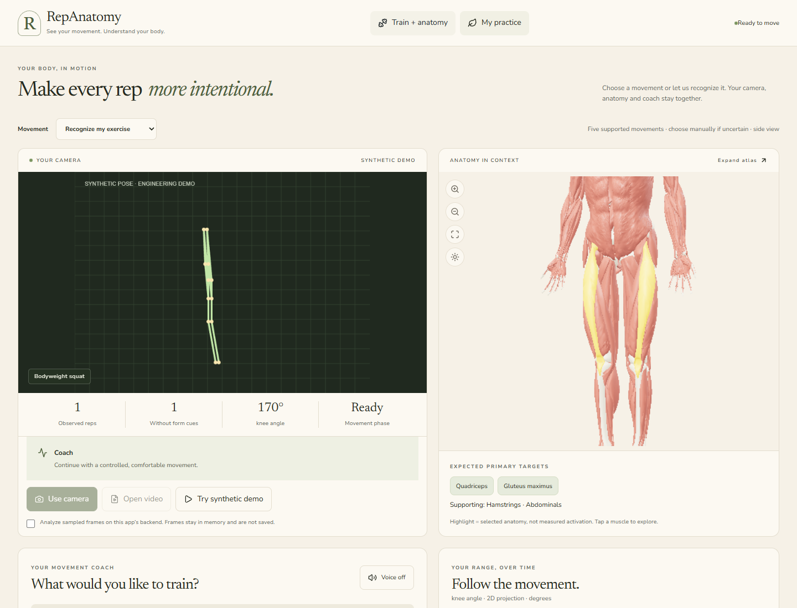
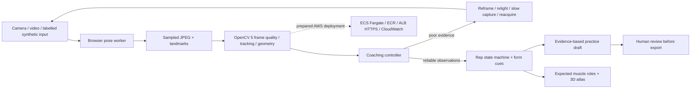

# RepAnatomy

**See your movement. Understand your body.**

RepAnatomy connects exercise practice with an interactive 3D anatomy atlas. Gym Studio combines browser pose estimation, substantive **OpenCV 5** frame analysis, rep tracking, expected muscle targets and a coaching controller whose decisions change when the visual evidence changes.

Built for the **OpenCV AI Competition 2026, powered by AWS**. This folder contains a working local prototype and an AWS deployment package. **AWS execution, a judge-accessible endpoint and a new submission video remain pending.** See the [competition checklist](docs/opencv/SUBMISSION_CHECKLIST.md) before making eligibility claims.



## Run locally

Use Node.js **24.22.1** (minimum 22.18), Python **3.12**, and a current Chromium browser. Start from the folder containing `package.json`.

```powershell
npm ci
npm run prepare:pose
python -m venv .venv
.venv\Scripts\python.exe -m pip install -r backend/requirements.lock.txt
```

Terminal 1:

```powershell
.venv\Scripts\python.exe -m uvicorn backend.main:app --host 127.0.0.1 --port 8000 --no-access-log
```

Terminal 2:

```powershell
npm run dev
```

Open **[Gym Studio](http://localhost:3016/?gym=1)**. The [standalone anatomy atlas](http://localhost:3016/?atlas=1) and [report companion](http://localhost:3016/?demo=1) remain available. No paid AI key is needed for fitness coaching or the synthetic demonstration. For macOS/Linux, use `.venv/bin/python` instead of `.venv\Scripts\python.exe`.

`prepare:pose` downloads a versioned pose model, checks its pinned SHA-256 and copies the matching WASM runtime into `public/pose`. Camera inference then uses local assets. The frontend development server proxies `/api` and `/mcp` to the backend. Use `REPANATOMY_API_TARGET` to select a different backend. [Detailed setup and use guide](docs/opencv/RUN_AND_USE.md).

## Train + anatomy

1. Tell the coach which muscles you want to train, or choose a supported exercise: squat, push-up, curl, shoulder press or lunge. **Recognize my exercise** uses repeated movement geometry and abstains when evidence is insufficient. It is not a trained, validated exercise classifier.
2. Enable frame processing and choose **Use camera** or **Open video**. Use one person, a stable side view, and a comfortable, controlled pace. The camera and interactive anatomy stay side by side. The synthetic demo is labelled and excluded from your daily totals.
3. Follow rep counts, visible-joint form cues, eight bilateral joint angles, the range chart, and per-rep duration/ranges. Tap an expected muscle target to highlight it in the atlas. No muscle activation or inactivity is measured.
4. Turn **Voice on** for spoken cues and replies. Tap the microphone to ask a question; say “stop session” to stop capture. Browser speech recognition may use its provider's speech service and may be unavailable; typing is always available. Set completion automatically requests a coaching review.
5. Open **My practice** for today's device-local camera/video totals, coaching, a weekly exercise draft and food preferences/exclusions. Review before exporting. Expand **Session measurements & diagnostics** to export bounded timestamped angle arrays or delete the active session.

## Groq coaching configuration

Copy `backend/.env.example` to `backend/.env`, add `GROQ_API_KEY`, and set `GROQ_MODEL` to an available model ID. Restart the Python backend. The existing default is `openai/gpt-oss-120b`; no key is shipped. `/api/fitness/coach/status` reports configuration without exposing secrets. A configured key is **not** proof of a successful provider connection.

**DeepSeek on Groq:** Groq's [deprecation documentation](https://console.groq.com/docs/deprecations) lists `deepseek-r1-distill-llama-70b` as retired on October 2, 2025. Do not use that ID expecting a working endpoint. The model remains configurable so you can use a currently available model in your account. Provider errors are shown and fall back to clearly labelled local coaching; no silent model substitution occurs in the fitness coach.

Only questions, recent valid/invalid angle samples, rep summaries, and planning preferences go to the configured LLM. Raw images are not sent to it. The LLM explains observations; it cannot change counts, exercise recognition or the latched pain stop. Optional `FITNESS_COACH_API_KEY`, `FITNESS_COACH_BASE_URL` and `FITNESS_COACH_MODEL` override the shared Groq configuration for another compatible provider.

## What runs in OpenCV 5

The server decodes JPEG frames, rescales and converts images to grayscale, measures Laplacian sharpness and exposure, tracks observations with pyramidal Lucas–Kanade optical flow, and projects normalized pose observations into pixel geometry. These results gate form cues and rep counting, change capture cadence, and influence the later practice draft.

Browser pose inference runs in a worker using a pinned MediaPipe Pose Landmarker model. A BODY_25 observation import adapter is also available. Exercise selection can be manual or automatic through a temporal geometry recognizer, with five agreeing observations, motion-range and elapsed-time gates. Recognition locks for the session and never switches silently between exercises. This recognizer has not been validated on a human dataset. No pretrained classifier accuracy from other applications is claimed.



## Verify

```powershell
npm run check
npm run lint
npm test
.venv\Scripts\python.exe -m unittest backend.test_fitness -v
.venv\Scripts\python.exe backend/test_backend.py
.venv\Scripts\python.exe -m unittest backend.test_mcp -v
npx playwright install chromium
npm run test:fitness:browser
npm run test:companion
npm run test:browser -- --project=chromium
npm run build
.venv\Scripts\python.exe -m backend.evaluate_fitness
```

Browser checks use their own backend and frontend ports. The vision tests cover all five synthetic movements, the actual local model/WASM initialization, consent, stop controls, plans, review/export, mobile layout and unavailable services. Evaluation fixtures and their limits are explained in the [technical report](docs/opencv/TECHNICAL_REPORT.md) and [verification record](docs/opencv/VERIFICATION.md).

## Build and AWS delivery

`npm run build` produces the web bundle and verifies its PWA manifest, branding, icons and model integrity. Production mode serves the web app, REST API and MCP endpoint from one Python process. The [AWS setup guide](deploy/README.md) and [deployment helper](deploy/deploy-aws.ps1) prepare ECS Express Mode on Fargate with a generated HTTPS URL, an immutable ECR image, exact host/origin configuration and CloudWatch logs. No custom domain or Streamlit rewrite is required. A [custom-domain Fargate template](deploy/aws-fargate.yaml) is also available. No AWS resources have been deployed. Source publication does not establish AWS execution.

The competition requires OpenCV 5 plus meaningful AWS execution; Streamlit and serverless are optional. Fargate provides serverless container compute while preserving the existing React/3D experience. After deployment, run `python scripts/smoke-deployment.py --url https://YOUR_ENDPOINT` to verify the remote synthetic workload and save its trace. Local checks and a prepared template do not establish AWS execution. The public deadline was October 26, 2026; confirm organizer permission/edit access for changes after that date.

The prepared architecture runs the OpenCV workload on AWS after deployment. COOL/Graviton acceleration is not implemented or claimed. The controller demonstrates the Agentic Vision perception–decision–action pattern; award qualification remains subject to the organizers' assessment.

## Scope and responsible use

- Five exercises, side-view 2D geometry and heuristic form cues. No measurement of forces, load, spinal position, injuries or muscle activation.
- No human-subject validation, clinical validation or comparative recognition benchmark yet. Synthetic tests establish engineering behavior only.
- Sessions are temporary, expire after 30 minutes, and disappear on backend restart. Only the prior reduced grayscale image and observations are retained for tracking; frames are not written to disk. Delete the session to release them immediately.
- Meal suggestions are general examples filtered by declared ingredients. They do not prescribe calories or guarantee allergen safety; check packaging and cross-contact. Medical nutrition needs require a dietitian.
- The cloud template is a bounded, public demonstration with at most 64 temporary sessions. Add identity, per-user quotas and durable isolation before a public production service. Use synthetic report data in public demos.

The retained report companion includes a real MCP server, PDF/text extraction, optional Groq explanations and paired-browser voice interaction. It is educational; the atlas shows reference anatomy. [Report/anatomy implementation details](README-technical.md). The documents under `docs/hackathon` describe the earlier report-focused workflow; current OpenCV submission material lives under `docs/opencv`.

## Documentation and credits

- [Run and use](docs/opencv/RUN_AND_USE.md)
- [Technical report and architecture](docs/opencv/TECHNICAL_REPORT.md)
- [Competition requirements and remaining evidence](docs/opencv/SUBMISSION_CHECKLIST.md)
- [Five-minute demonstration script](docs/opencv/DEMO_SCRIPT.md)
- [Verification record](docs/opencv/VERIFICATION.md)
- [Exercise and nutrition references](docs/opencv/SOURCES.md)
- [Asset attribution and licenses](public/ATTRIBUTION.md)

Project code is covered by the existing [MIT license](LICENSE); anatomy assets, pose runtime and model materials retain their applicable terms. Branding does not replace third-party attribution.
