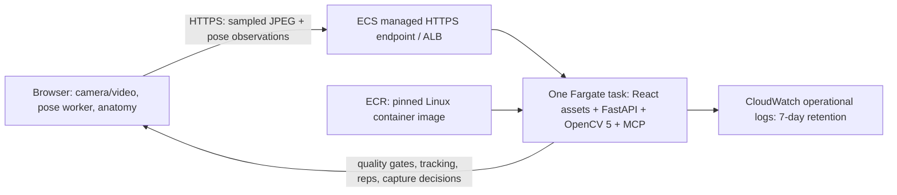

# Deploy RepAnatomy on AWS

**Status: prepared and locally checked; nothing deployed.** The requested deliverable is the project and setup guide. An AWS account and Docker Engine are not connected in this environment. CloudFormation schema checks, mocked orchestration and a local production HTTP check passed; AWS provisioning and Linux container execution remain unverified here.

## What the hackathon actually requires

The [official requirements](https://opencv26.devpost.com/) require substantive **OpenCV 5** image/video processing and a meaningful component running on **AWS**. Streamlit is optional. Serverless is an allowed architecture, not a mandatory framework. The [Gymnalyze entry](https://devpost.com/software/gymnalyze-real-time-gymnastics-discipline-identification) and [its repository](https://github.com/krinachauhan006/Gymnalyze) describe Streamlit on **EC2**, a server-hosted application.

RepAnatomy keeps its existing React interface, camera worker, 3D anatomy and FastAPI/OpenCV backend. Deploying that backend on AWS runs the actual vision workload there. A static GitHub Pages deployment alone does not run this backend.

The public competition page still lists **October 26, 2026, 11:59 p.m. Pacific** as the submission deadline. As of **November 5, 2026 IST**, this has passed. Confirm whether your existing submission can be updated or the organizers permit changes; code preparation does not reopen entry access.

## Recommended architecture

[Amazon ECS Express Mode](https://docs.aws.amazon.com/AmazonECS/latest/developerguide/express-service-getting-started.html) runs the container on serverless Fargate compute and provides an AWS HTTPS hostname. You do not need your own domain, SSL certificate, SSH key or EC2 server. This is an always-running demonstration; it does **not** scale to zero.



[aws-express.yaml](aws-express.yaml) creates a dedicated VPC, public subnets in two availability zones, routes, ECS cluster, roles and log group. ECS manages the load balancer, TLS, ingress security groups and service. The app runs one worker, and minimum/maximum task counts are both one because workout/report sessions are in memory. Replacement or deployment invalidates sessions; do not demo during a rollout, which can temporarily run old and new revisions. Horizontal scaling requires shared isolated session storage first. COOL/Graviton acceleration is not included.

## 1. Create your account and tools

1. Create an [AWS account](https://aws.amazon.com/), set up MFA and a billing budget/alert. Use a non-root deployment identity. Your account administrator must grant deployment permissions for CloudFormation, ECR, ECS, IAM role creation/passing, EC2 networking, ELB, ACM, CloudWatch and Application Auto Scaling. The helper refuses a root identity. The ECS infrastructure role uses AWS's managed Express Mode policy; the application itself is not given AWS API permissions.
2. Install current [AWS CLI v2](https://docs.aws.amazon.com/cli/latest/userguide/getting-started-install.html), [Docker Desktop](https://docs.docker.com/desktop/setup/install/windows-install/) and [PowerShell 7](https://learn.microsoft.com/powershell/scripting/install/installing-powershell-on-windows). Start Docker using Linux containers.
3. Install the project's Node/Python dependencies and prepare pose assets using the [main README](../README.md#run-locally). Python dependencies are needed to run the endpoint checker. `docker build` prepares its own dependencies and browser model.
4. Open PowerShell 7 in the project root. Use a region offering ECS Express Mode, for example `ap-south-1` if available in your account. All resources and the ECR image must use that same region.

Fargate, the load balancer, ECR storage, public IPv4, logs and data transfer can incur charges, including while the app is idle. Credits depend on your account and plan. This project does not claim free hosting or a measured cost. Check your account's service access, credit eligibility and AWS pricing before running the deployment.

## 2. Sign in without sharing access keys

For a non-root console identity, AWS CLI 2.32.0+ supports [browser sign-in](https://docs.aws.amazon.com/cli/latest/userguide/cli-configure-sign-in.html):

```powershell
aws login --profile repanatomy --region ap-south-1
aws sts get-caller-identity --profile repanatomy
```

Your identity needs `SignInLocalDevelopmentAccess` for this flow, in addition to deployment permissions. If your organization uses IAM Identity Center, use `aws configure sso --profile repanatomy` and `aws sso login --profile repanatomy` instead. Keep credentials in AWS's local credential store, outside the project. Never paste credentials into chat, source files or the container.

Copy the 12-digit `Account` value printed by `get-caller-identity`. The next command checks that account before making changes.

## 3. Build and deploy

Replace the example account ID:

```powershell
./deploy/deploy-aws.ps1 -Region ap-south-1 -ExpectedAccountId 123456789012 -Profile repanatomy
```

The helper:

1. Checks the identity and existing stack status; it does not treat access errors as missing resources.
2. Creates an ECR repository if absent, builds the existing Dockerfile for `linux/amd64`, logs in with a short-lived token and pushes a uniquely tagged image.
3. Resolves its immutable image digest, validates the template and deploys the CloudFormation stack `repanatomy-demo`.
4. Reads ECS's generated HTTPS hostname and updates the **exact** Host/Origin allowlists. Initial health probes work while application requests remain blocked during bootstrap. There is no wildcard origin/host configuration.
5. Prints the judge URL and writes non-secret resource/image identifiers to `outputs/deployment/aws-stack.json`.

First deployment runs two stack operations to discover and configure the hostname. Updates preserve the existing hostname and use a new image digest. Provisioning can take several minutes. If a command fails, inspect the AWS error and CloudFormation stack events; do not create duplicate stacks. A rolled-back creation may need explicit cleanup in the console before retrying.

If you already have a built Linux image in the same account/region's ECR, a machine with AWS CLI and PowerShell can skip Docker:

```powershell
./deploy/deploy-aws.ps1 -Region ap-south-1 -ExpectedAccountId 123456789012 -Profile repanatomy -ImageUri '123456789012.dkr.ecr.ap-south-1.amazonaws.com/repanatomy@sha256:REPLACE_WITH_64_HEX_DIGEST'
```

For a custom domain and explicit ALB configuration, the existing [Fargate alternative](FARGATE.md) remains available.

## 4. Verify the deployed workload

Use the HTTPS origin printed by the helper, without `/?gym=1`:

```powershell
.venv\Scripts\python.exe scripts/smoke-deployment.py --url https://YOUR_SERVICE.ecs.ap-south-1.on.aws --output outputs/deployment/workload.json
```

This creates one explicitly **synthetic** workout, sends an original synthetic full rep and dark JPEG through the real remote OpenCV pipeline, checks the changed capture action, latches a human stop and deletes the session. It also checks the web page, OpenCV version, pinned model checksum, WASM files, rejected unrelated Origin and MCP initialization. It records a timestamp, runtime, observations and controller trace without session tokens. A failing run exits nonzero and does not write a new success record. Check evidence timestamps when rerunning.

`aws_execution_verified` intentionally remains `false`: the application does not certify its own hosting based on an environment variable. Pair the workload record with the stack/image/service identifiers and actual running-task evidence from the AWS console. The ECS metadata-presence field is only a runtime hint.

Then open the judge URL in a separate browser:

1. Run **Try synthetic demo**, inspect the anatomy/trace, create a draft and review/export it.
2. Consent to frame processing and test your physical camera or a consented exercise video over HTTPS. Check poor lighting, stop, recovery, session deletion and phone layout.
3. Record the actual AWS region, task/image digest, OpenCV version, endpoint and test timestamp. Keep real-clip results separate from synthetic engineering checks.
4. Record a new video of at most five minutes following [the demo script](../docs/opencv/DEMO_SCRIPT.md). Provide the technical report, evaluation/failure cases and judge-accessible source archive/repository. See [the remaining checklist](../docs/opencv/SUBMISSION_CHECKLIST.md).

No Groq key is needed for synthetic demos or local deterministic fitness coaching. Optional remote LLM coaching can be configured later with ECS secret injection; never build a key into the image or put it in a CloudFormation plaintext parameter. No secret integration is configured by this template.

## Local and CI checks

```powershell
./scripts/test-deploy-aws.ps1
docker build --platform linux/amd64 -t repanatomy:check .
docker run --rm -p 127.0.0.1:8000:8000 repanatomy:check
```

In a second terminal:

```powershell
.venv\Scripts\python.exe scripts/smoke-deployment.py --url http://127.0.0.1:8000 --allow-local-http --output outputs/container-workload.json
```

The [container workflow](../.github/workflows/container.yml) runs mocked deployment cases, schema validation, a Linux Docker build and the HTTP workload checker on GitHub Actions. Trigger **Validate AWS container** manually after uploading the project to a repository with Actions enabled. This workflow does not publish an image, deploy to AWS or establish AWS execution evidence. It has not run from this local source folder.

## Troubleshooting

| Symptom | Action |
| --- | --- |
| `aws` or `docker` not found | Install the tools above and reopen PowerShell 7. Start Docker Desktop. |
| Account mismatch or root identity rejected | Sign in with the intended non-root profile; verify `get-caller-identity`. |
| `AccessDenied` or role-assumption failure | Review the deployment identity's permissions and CloudFormation events. New IAM roles can take time to propagate. |
| Express Mode unsupported in the region/account | Check service availability/access; use a supported region or the custom-domain Fargate alternative. |
| `/healthz` succeeds but the web app returns 400/403 | Wait for the second hostname configuration operation; check the exact Host/Origin env values. |
| Workout disappears during deployment | Start a new session after the rollout. Sessions are temporary and process-local. |
| Camera fails on a raw IP / HTTP URL | Use the generated HTTPS URL and grant browser camera permission. |
| Hostname changed after replacing the service | Rerun the helper to configure the new exact hostname, then use the new endpoint. |

## Remove the demo when finished

Record evidence first. In the AWS console, confirm the account, region and **repanatomy-demo** stack before deleting it. Wait for deletion to finish and check for failed deletions and ECS-managed resources. The helper-created **ECR repository/images are outside that stack**; remove them separately if no longer needed. Check CloudWatch, load balancers, tasks and public networking/billing for leftovers. This guide does not run cleanup or remove resources automatically.
