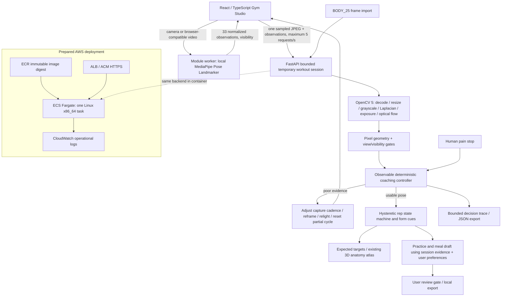

# RepAnatomy — OpenCV 5 technical report

## Problem and users

People learning basic resistance exercises can count movements without understanding their relationship to anatomy. RepAnatomy helps adult recreational users inspect approximate movement cues, learn expected muscle roles and prepare conservative practice drafts for review with a trainer. It extends an existing 3D reference anatomy and report-conversation application. This is an educational prototype, not an injury detector or clinical tool.

## Architecture

## OpenCV implementation

Runtime `cv2.__version__` is checked at import: major version 5 is mandatory. The validated wheel is `opencv-python-headless==5.0.0.93` (runtime version `5.0.0`). A JPEG header check rejects oversized images before decoding. Frame size is bounded to 921,600 pixels, at most 1280 per side; the regular client submits a maximum 640×480 frame.

1. `imdecode` produces a BGR image. `resize` and `cvtColor` create a reduced 320×240 grayscale image.
2. `Laplacian(..., CV_64F).var()` estimates sharpness. `mean()` estimates exposure. These measurements control whether analysis may continue; they are not cosmetic statistics.
3. `calcOpticalFlowPyrLK` tracks the prior joints in the reduced frames. When at least two tracks exist, median disagreement against the current detector observations greater than 45 pixels triggers reacquisition. The threshold is an engineering heuristic, not a calibrated detector error bound.
4. `transform` maps normalized coordinates into source-pixel geometry. `norm` and vector angles estimate knee, elbow and trunk relationships. This avoids the aspect-ratio error of directly using normalized x/y coordinates.
5. Confidence, cropping, frontal views, mismatched posture and missing/degenerate joints gate the observations. Inadequate evidence resets a partial rep cycle.

The pose model supplies observations; OpenCV image analysis determines whether the controller uses them. Pose estimation itself runs in the browser, not inside OpenCV. Client observations are untrusted input and are not independent verification of a person's exercise technique.

## Controller and human control

The controller is a deterministic agent-style state machine, with no LLM dependency. Perception changes its next action and the next capture interval (200 or 500 ms plus processing/network time). Trace entries record frame index, observation time, decision and reason. They do not record the source image.

| Perception | Action | Later effect |
| --- | --- | --- |
| Exposure under 35 or over 235 | Ask for better lighting; slower recapture | Pause counts and clear partial cycle |
| Sharpness under 8 | Ask to steady/refocus; slower recapture | Pause form judgment |
| Missing or low-visibility joints | Request reframing | Prevent bridging an invisible rep interval |
| Frontal view / cropped joints | Request side view / more room | Require fresh usable observations |
| Abrupt tracking disagreement / timestamp gap | Reacquire | Clear partial cycle |
| Reliable complete cycle | Count observed rep | Separate cycles with form cues from those without |
| Cues, no accepted cycle or poor latest evidence | Technique-review practice draft | Require user review before export |
| Pain/dizziness or declared clinical needs | Stop / human review | No practice or meal schedule issued |

The controller does not change the selected exercise, raise a load, prescribe calories, or publish a plan. The user chooses the movement and reviews the draft. A pain stop remains latched for the session. Repeated planning cannot erase the latest visual evidence: draft events are stored separately from the last vision action.

## Rep and form logic

Five explicitly selected exercises use an extended → flexed → extended cycle. Each has distinct low/high thresholds in `data/fitness/exercises.json`; hysteresis prevents jitter near one threshold from creating multiple reps. Cycles last 0.7–12 seconds, and visible continuity is required. A cue anywhere in a cycle marks that completed cycle for review.

Push-ups receive a shoulder–hip–knee alignment cue. Curls and presses receive trunk-control cues; curls also check upper-arm displacement. Squat/lunge counting uses knee geometry, with instructional cues rather than automated claims about knee valgus or spinal alignment. These thresholds and rules are prototype heuristics. An observed cycle without a triggered cue is not certified correct form. Lunge leg switching, asymmetric movements, camera perspective and assistive devices require further validation.

## Muscles and planning

Primary/supporting roles are anatomical expectations. No EMG, force sensor, load estimate or activation percentage exists. Other muscles are described as not primary targets rather than inactive. Atlas links search verified model structures and show an available matching structure or search result.

The meal generator uses authored meal examples and ingredient tags, filters declared food preferences and exclusions, and cites a balanced-eating reference. It provides no nutrient calculation or individualized therapeutic diet. Clinical needs gate the whole draft for human review. Four-day practice schedules alternate lower/upper body; 2–3 days use separated general-practice days. This is a reviewable draft rather than adaptive medical exercise programming.

## Dependencies and provenance

JavaScript versions are pinned in `package.json`/`package-lock.json`. `backend/requirements.txt` pins direct Python dependencies; `backend/requirements.lock.txt` captures the validated Python 3.12 environment with a Windows-only marker for pywin32. `data/fitness/pose-model.json` records the versioned model URL, bytes and SHA-256. The preparation command verifies the model digest before using it. WASM comes from the pinned npm package. Core implementation, exercise summaries and synthetic fixtures were authored locally; no external trainer source or pretrained classifier was vendored.

The BODY_25 adapter accepts the standard 25-joint output format. It is interoperability with previously produced observations; no external GPU pose engine is installed. Existing anatomy attribution remains in `public/ATTRIBUTION.md`.

## AWS delivery

The Docker build compiles the frontend, prepares local pose assets and installs the pinned backend. Production ASGI dispatch serves static web assets and the existing `/mcp` endpoint on the same origin as REST. The container runs as user 10001, with one worker and HTTP access logs disabled.

The original custom-domain CloudFormation stack provisions a VPC, two public subnets, an HTTPS ALB, security groups, ECS Fargate service, task/execution roles and seven-day CloudWatch logs. Container ingress is restricted to the ALB security group. An existing ACM certificate and immutable ECR image digest are parameters. A minimal `/healthz` probe supports the ALB's container-IP Host header without exposing application data. Host and origin allowlists protect application endpoints.

The recommended [ECS Express Mode template](../../deploy/aws-express.yaml) adds managed TLS and an AWS-generated hostname, removing the custom-domain/certificate prerequisite. The [deployment helper](../../deploy/deploy-aws.ps1) builds/pushes the Linux image and configures the exact generated Host/Origin in a second stack operation. Both scaling limits are one. The original custom-domain template remains an alternative. Express Mode rollouts can temporarily run multiple revisions; do not rely on session continuity during updates. The [endpoint checker](../../scripts/smoke-deployment.py) sends labelled synthetic frames, verifies a complete rep and lighting-driven action change, checks a latched stop, assets and MCP, then deletes its session. Pair that trace with AWS resource/task evidence; it is not proof of human accuracy or independently verified hosting.

**The stack has not been deployed. Docker execution and AWS runtime measurements are pending.** Source templates and local HTTP checks are not evidence of cloud execution. COOL is not used; this is an x86_64 path with no Best Use of COOL claim. One task is deliberate because session state is process-local. Replacements invalidate sessions. Public production use would need identity, per-user quotas, WAF/rate controls, durable isolated state, a load study and a reviewed privacy policy.

## Evaluation method and results

`python -m backend.evaluate_fitness` creates original synthetic JPEGs and geometric observations, then runs the actual HTTP API/OpenCV pipeline. It records runtime versions, environment, exact count outcomes, quality-action changes, false counts on static input and measured processing time in `evidence/synthetic-evaluation.json`. The generator bypasses only HTTP pacing for deterministic fixture throughput; these are local synthetic API processing times, not camera FPS or AWS latency.

Regression suites cover geometry, partial cycles, tempo, lost poses, form-cue contamination, BODY_25 conversion, exposure/blur/view gates, clinical review, plan changes, ingredient filtering, expiry, isolation, request validation, host/origin guards and frame bounds. Browser suites exercise the synthetic UI flow, real local model/WASM startup, fake-camera no-person handling, controls, plans, review/export and mobile layouts. Existing anatomy/report tests remain separate regression evidence. See the current [verification record](VERIFICATION.md).

**No human-subject exercise accuracy, form-rating agreement, demographic subgroup results, AWS latency or cost reduction is established.** Before those claims, collect consented labelled clips across people, lighting and camera viewpoints; have qualified trainers annotate reps and errors; separate participants across development and evaluation; report rep MAE, exercise confusion matrix, cue precision/recall, abstention rate, latency percentiles and failure cases. Use independent review and retain consent/provenance records.

## Privacy and limits

Capture requires explicit consent. Source frames are handled in memory; the prior reduced grayscale frame and selected points persist only within a temporary session for tracking. Session capacity is 64 and expiry is 30 minutes; background cleanup runs every 30 seconds. Deleting a session or restarting the backend clears its state. Camera tracks, workers and video URLs are released on stop or tab hiding. Session capabilities are private bearer tokens and should never be pasted into a public issue.

This implementation cannot detect all harmful technique, infer pain, measure muscle activation, assess readiness or replace a trainer/clinician. Unfamiliar or ambiguous observations should result in abstention and human review, and all evaluation claims must describe the actual evidence source.
